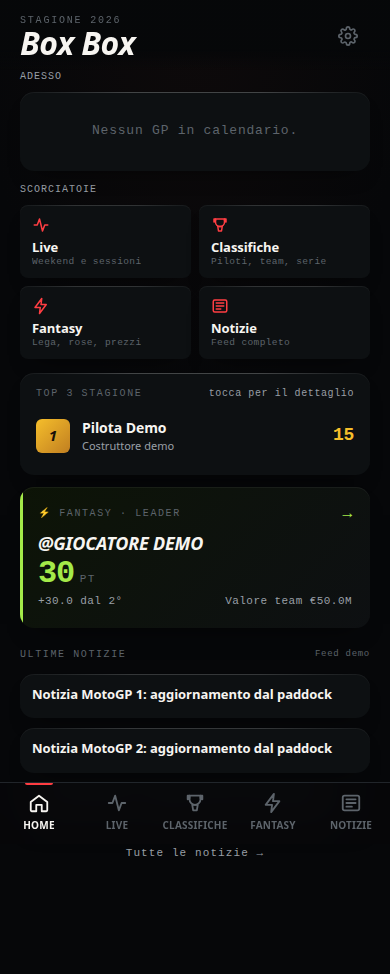
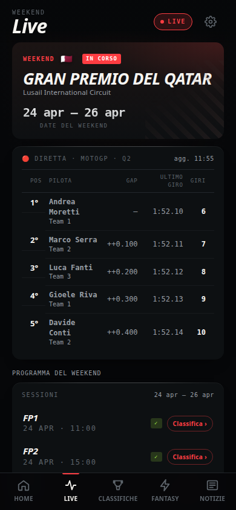
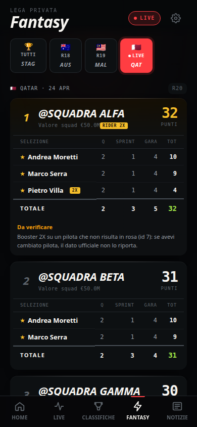

# Box Box 🏎️


PWA e pipeline dati per seguire la MotoGP e il campionato Fantasy in una lega privata tra amici.

L'ho costruita perche' l'app ufficiale Fantasy MotoGP e' lenta, piena di annunci e mostra solo il punteggio aggregato. Volevo un'interfaccia leggera e consultabile offline che spiegasse subito da dove arrivano i punti: qualifiche, sprint, gara e bonus, pilota per pilota.

> **Contesto e note legali.** Progetto personale per uso privato, non affiliato a Dorna Sports o MotoGP. Raccoglie i dati tramite le API di `fantasy.motogp.com` per i soli partecipanti alla lega.

## Provalo in due minuti

Per eseguire i test deterministici non servono credenziali, Docker o accessi di rete:

```bash
# 1. Esegui la suite di test (booster, ordinamento eventi, contratto LLM)
bash scraper/test-audit.sh

# 2. Genera le 16 schermate con Chromium headless su dati sintetici
node scraper/test-browser.mjs

# 3. Avvia il server statico locale per navigare l'app
python3 -m http.server 8080
```

Apri `http://localhost:8080`: il frontend viene eseguito direttamente dal browser senza alcuno step di compilazione.

## Interfaccia

Le immagini sono generate in automatico da `scraper/test-browser.mjs` con dati sintetici: nessun nome reale di giocatore, nessuna chiamata esterna.

| Home | Live | Fantasy (con avvisi) |
| :---: | :---: | :---: |
|  |  |  |

- **Home**: stato del prossimo GP, classifica sintetica piloti e leader della lega.
- **Live**: sessioni del weekend in corso, stato, orari e tabellone con distacchi e giri completati.
- **Classifiche**: piloti MotoGP, costruttori, team, calendario completo e classifiche Moto2, Moto3 e WorldSBK.
- **Fantasy**: andamento punteggi per GP, storico prezzi piloti e sezione valore (punti per milione speso).
- **Notizie**: rassegna stampa con analisi automatica del sentiment per ciascun pilota tramite LLM (NVIDIA NIM).
- **Impostazioni**: preferenze locali, notifiche in-app e scorciatoie utili.

L'archivio completo di tutte le 16 viste desktop (1440x1000) e mobile (390x844) si trova in [docs/verifiche/](docs/verifiche/LEGGIMI.md).

## Trasparenza sui dati: il blocco «Da verificare»

Nel gioco ufficiale capita che il sistema registri l'attivazione di un booster senza applicare i cambi di formazione associati, o che compaiano modalita' speciali non documentate come `wildcard`.

BoxBox non riscrive i punteggi ufficiali: la graduatoria della lega deve coincidere con quella del regolamento. Quando un dato non e' spiegabile, il motore calcolo aggiunge un blocco giallo **«Da verificare»** nella scheda del GP e nel log del cron:

1. **Booster fuori rosa**: booster 2X applicato a un pilota che non risulta tra i titolari della squadra.
2. **Rosa invariata con booster**: formazione identica al GP precedente nonostante un booster consumato.
3. **Booster non modellato**: uso di gettoni speciali di cui il regolamento ufficiale non descrive la formula esatta.

In questo modo chi consulta l'app sa se una variazione di punti deriva dalla gara o da un'anomalia della fonte.

## Architettura e scelte tecniche

### Frontend no-build
Il frontend (~1400 righe di codice) usa ES modules nativi del browser (`<script type="module">`). Nessun bundler, nessun framework, nessun `npm install`:
- **Nodi DOM sicuri** (`dom.js`): i dati esterni vengono inseriti solo come testo (`textContent`), mai interpretati come codice HTML.
- **Service Worker** (`sw.js`): cache-first per i file dell'applicazione (versione `boxbox-public-v22`), network-first con fallback offline per i file JSON dei dati.
- **Stato reattivo minimale** (`state.js`, `ui.js`): routing basato su hash (`#/live`, `#/fantasy`), rendering mirato della sola vista attiva.

### Pipeline dati
La pipeline gira sotto Node.js ed e' orchestrata da cron con cadenze adattive:
- **Regime orario**: aggiornamento classifiche e rose durante la settimana.
- **Regime weekend di gara**: controlli frequenti (ogni 2-15 minuti) durante le sessioni in pista.
- **Pre-lock squadra**: monitoraggio delle modifiche dell'ultimo minuto con notifiche via webhook Discord.
- **Rinnovo sessione**: recupero headless del token di sessione Dorna tramite Chromium (`scraper/renew-dat.mjs`).

### Dipendenze
- **Browser e calcolo punteggi**: zero dipendenze esterne.
- **Rinnovo automatico della sessione**: `playwright-core` (eseguito dal cron sul server).
- **Verifica grafica con screenshot**: `playwright` (strumento di sviluppo e CI).

## Setup per la produzione

```bash
cd scraper
cp .env.example .env   # inserisci LEAGUE_ID e credenziali Dorna
cd ..

# Primo popolamento dati
bash cron/boxbox-cron.sh
bash cron/boxbox-news.sh

# Avvio del container Nginx
docker compose up -d --build
```

I file generati vengono scritti dentro `data/`, cartella montata in sola lettura nel container web.

## Verifiche e test automatici

Il progetto include suite di test isolate:

```bash
# Test unitari deterministici (48 asserzioni su booster, logica e avvisi)
npm --prefix scraper test

# Test integrazione cronologia eventi e contratti news
node scraper/test-event-order.mjs
node scraper/test-news-classification.mjs

# Test end-to-end con Chromium headless (desktop e mobile)
node scraper/test-browser.mjs
```

Documentazione dettagliata dell'architettura: [ARCHITETTURA.md](ARCHITETTURA.md).

## Limiti noti

- **Dipendenza da API esterne**: se Dorna modifica gli endpoint non documentati o la struttura del login, la pipeline richiede un aggiornamento manuale.
- **Rinnovo headless**: dipende dalla stabilita' visiva della pagina di autenticazione Dorna.
- **Regole speciali**: gettoni come `wildcard` restano segnalati come non modellati finche' la formula dei punti non viene chiarita ufficialmente.

## Licenza

MIT. Vedi [LICENSE](LICENSE).
